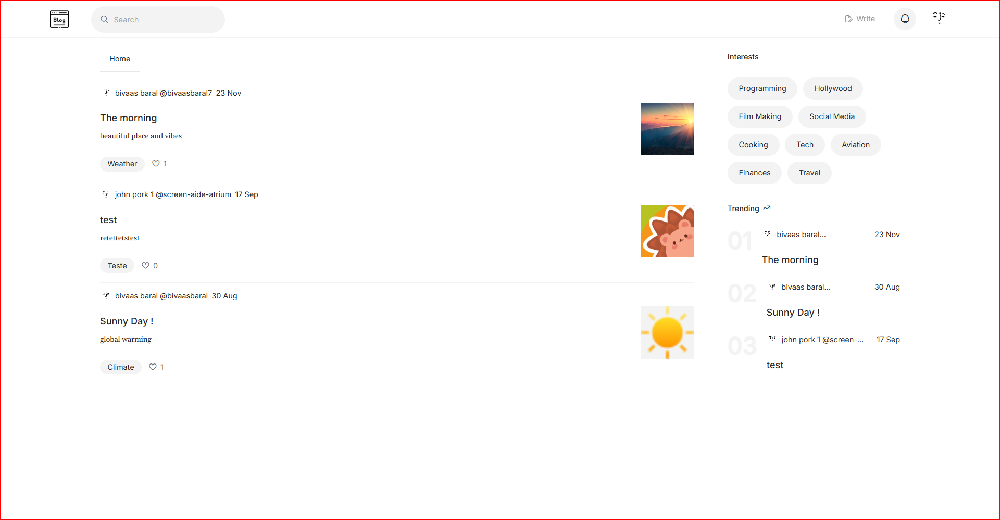
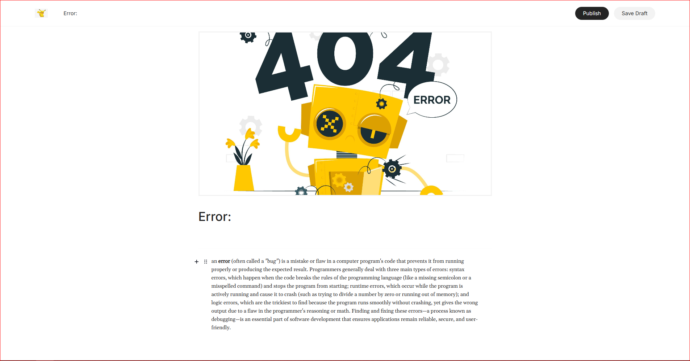
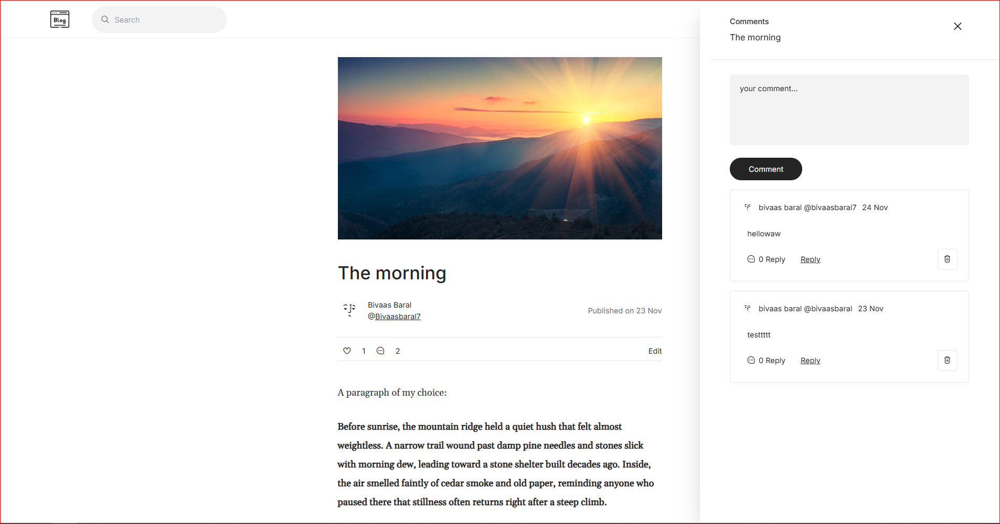

# Bloggo Folio

A site made personally for me to write blogs in near-future. This site is somewhat inspired my medium where we sign in, post in block editor, publish it and then displays in homescreen for everyone to read. If you're thinking how I ended up with this, I even dont know. The two words "blog" and "portfolio" came into my find, I thought of some combinations then got this name. 

I originally thought of building this to write whatever comes into my mind. I also thought of having it as subdomain of my site but I wont be doing it since this project is currently MVP2 with some features still remaining. I badly underestimated how much time would be required for this project. In the time I imagined for this project to be complete, I could only complete a basic working prototype. 

After my first MVP, I added search, profiles page, trending, interests, likes, editing and full comment system with replies and count. I still have to work on Notifications (for likes and comment), a dashboard and minimal settings page.


# Tech-stack

Frontend built with React, vite, tailwindcss, EditorJS\
Backend with express and Node.js \
Authentication with JWT, bcryptjs and firebase\
MongoDb as database\
Image hosted as imgbb\

## Dependencies

react-router-dom\
axios\
firebase\
react-hot-toast\
editorjs\

express\
mongose\
cors\
bycriptjs\
jwt\
dotenv\
nodemon\

## Features

Firstly, all blogs are public and appears in homepage. For login, manual credentials or google oauth login is available and username is set accordingly. For blog, banner, title, short description, tags and main contents can be written. Blog author can also edit from the published blogs. A search feature to find blogs, tag and user. The tags help in search and ranking on relevant topics I selected. Each user also has a profile with blogs, total posts and views. If you find a blog awesome, you can like it and comment as well. The replies for comments also works. Each comments and blog can also be deleted. In page, blogs and comments are loaded 5 times at once with load more btn.  


*Home page showing all public blogs*


*Interface during publishing a blog*


*Opening comment section of a blog*



# Use of AI 

I used AI for error diagnosis, frontend validations, proper implementation of Authentication and Authorization, fix typos, error handling and to take suggestions with explanation. I used AI only to fix my code and achieve what I was trying to make and also while planning about the project and its basic structure. 

# Extras

The frontend is react and vite with Express. I used bcryptjs for hashing email/password and returns JWT. Google sign in gets firebase token and server verifies it then its just token. Posts are also stored in mongoDB as JSON because I can change how code block looks later without touching any saved post. I have used imgbb to store banner of each blogs. 

I once kept EditorJS instance in react state in editor page when I published, due to the editor isready state getting true the content went lost to it. so, publish click means empty post saved. so, never doing that again and its fixed now. 

comments are one collection and every parent keeps list of its replies and where loading more, deleting would work. It was also a lot frustating too.


# Everything I've used: 

```
Flaticon icon set: https://cdn-uicons.flaticon.com/uicons-regular-rounded/css/uicons-regular-rounded.css
Avatars: https://www.dicebear.com/
Img hosting (banner) : https://api.imgbb.com/
Firebase: https://console.firebase.google.com/
MongoDB: https://cloud.mongodb.com/
```